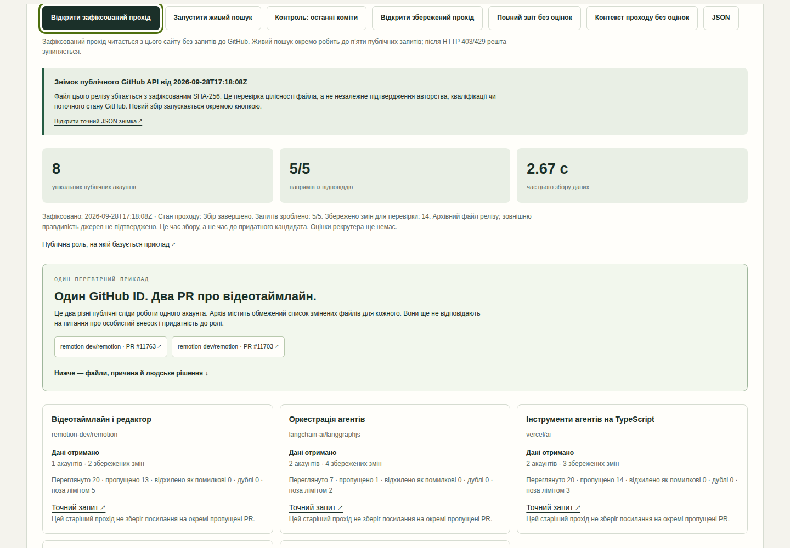

# Signal Desk

A browser-based research workbench: inspect public sources, record a human decision, and hand a readable research brief to the next person.

**[Open the demo →](https://diadkoshmek.github.io/talent-research-workflow-prototype/?lang=en&showcase=1)** · **[Українською](https://diadkoshmek.github.io/talent-research-workflow-prototype/?lang=uk&showcase=1)**



## Try it in three steps

1. Open the recorded pass and inspect a linked PR. It is a historical public GitHub API capture from **28 September 2026**, not a fresh search.
2. Record a reasoned source decision and select an account for **further research**. No assessment is prefilled.
3. Export the local handoff card. A separate **Run live search** button makes fresh public API requests.

The other path is a guided, fictional review example: accept or reject evidence, approve a handoff, then withdraw supporting evidence and see the approval close.

## What this explores

- Keeping findings connected to exact sources and human reasoning.
- Showing incomplete or rate-limited research without replacing earlier decisions.
- Passing useful context between people without treating a source match as a hiring decision.

This is an independent prototype, not a deployed recruiting system. It does not rank, contact or hire people, connect to an ATS, or establish time saved. The recorded pass and fictional queue are separate. [Scope and limits](docs/limits.md).

## Run and test

No packages, API key or login are needed. Use Python 3 to serve the app and Node 20+ for tests.

```bash
python3 -m http.server 8873 --bind 127.0.0.1
# Open http://127.0.0.1:8873/
```

```bash
npm test
npm run stress
```

## Read further

[Technical reference](REFERENCE.md) · [Architecture](docs/architecture.md) · [Verification](docs/verification.md) · [Security](docs/security.md)

For offline reading, save the [English HTML brief](docs/meeting-brief.en.html) or [Ukrainian PDF](docs/meeting-brief.uk.pdf) before losing the site connection.

**Built by DiadkoShmek with Codex.** DiadkoShmek supplied the brief and direction; Codex produced the implementation and automated checks. Independent work, not affiliated with or endorsed by A-Players. [Profile and contact](https://github.com/DiadkoShmek).
